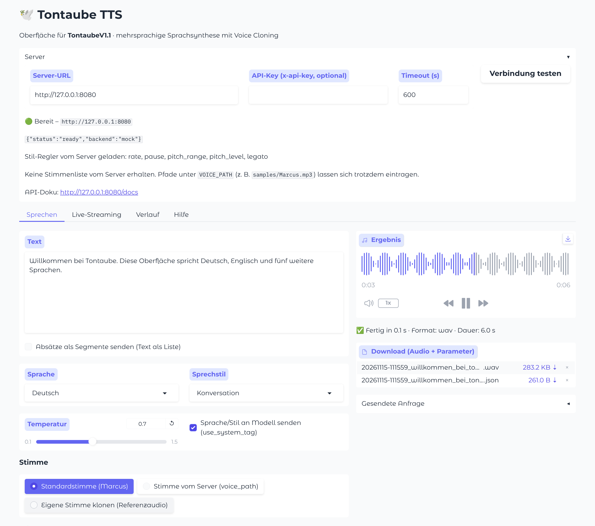

# Tontaube TTS GUI

Eine Weboberfläche (Gradio) für das Sprachsynthese-Modell
[**TontaubeV1.1**](https://huggingface.co/TontaubeAI/TontaubeV1.1).



## Funktionen

| Bereich | Was die GUI kann |
|---|---|
| **Sprachen** | Deutsch, Englisch (Hauptsprachen) sowie Spanisch, Französisch, Italienisch, Niederländisch, Portugiesisch |
| **Sprechstile** | Konversation, Hörbuch, Agentisch (`tag`) |
| **Stil-Regler** | Tempo (0–4), Pausen (0–4), Tonhöhen-Umfang (0–5), Stimmlage (0–4), Artikulation/Legato (0–2). Jeder Regler einzeln aktivierbar, sonst entscheidet das Modell. Die Regler werden beim Verbinden live von `GET /controls` geladen. |
| **Stimmen** | Standardstimme (Marcus), mitgelieferte Stimmen per `voice_path`, **Voice Cloning** mit eigenem Referenzaudio (Upload oder Mikrofon, 5–60 s, mit Längenprüfung) |
| **Sampling** | Temperatur (Standard 0.7) |
| **Lange Texte** | Absätze als Segmente senden, optional mit eigenen Reglern pro Segment (`segment_controls`) |
| **Fortsetzen** | Neuen Text nahtlos an das letzte Ergebnis anhängen (`prefix_text` / `prefix_tokens`); WAV-Teile werden automatisch zusammengefügt |
| **Live-Streaming** | MP3-Streaming über `/stream` (SSE) mit sofortiger Wiedergabe, einstellbar: Bitrate, Priorität, `max_new_tokens`, Länge des ersten Chunks |
| **Nachbearbeitung** | MossFormer2-Verbesserung (48 kHz) an/aus, Rand-Stille trimmen (Standard / aus / eigener Wert) |
| **Verbalizer** | Optional englischen Verbalizer nutzen (Zahlen, Abkürzungen ausschreiben) |
| **Export** | WAV, MP3 oder Opus. Jede Datei wird mit einer JSON-Datei der verwendeten Parameter in `outputs/` gespeichert und ist in der GUI herunterladbar |
| **Verlauf** | Alle Ergebnisse der Sitzung mit Download |
| **Server** | Frei wählbare Server-URL, API-Key (`x-api-key`), Verbindungstest (`/readyz`), Anzeige der gesendeten Anfrage, freie Zusatzfelder als JSON |

## All-in-one-App für macOS (Apple Silicon)

> **Experimentell.** Der offizielle Tontaube-Server unterstützt macOS nicht. Diese App bringt
> einen kleinen Patch mit, der den Server auf Apple Silicon lauffähig macht (siehe unten).

Die App richtet beim ersten Start alles selbst ein:

1. Oberfläche installieren (ca. 1–2 Minuten)
2. Tontaube-Server v1.1.0 herunterladen und für Apple Silicon anpassen
3. Python-Umgebung mit PyTorch einrichten (einige Minuten)
4. Modelle herunterladen (ca. 8,6 GB, nur beim ersten Start)

Den Fortschritt zeigt die Oberfläche oben an. Ab dem zweiten Start ist sie nach kurzer Zeit bereit.

### Installation (fertiges DMG)

1. Neueste Version laden: [Releases → neueste Version](https://github.com/sebmue78/TontaubeTTSGUI/releases/latest) → `Tontaube-TTS-X.Y.Z-macOS-AppleSilicon.dmg`
   (auf einem Apple-Silicon-Runner gebaut und getestet, siehe [Versionen und Releases](#versionen-und-releases)).
2. DMG öffnen und **Tontaube TTS** in den Ordner **Programme** ziehen.
3. Beim ersten Öffnen: Rechtsklick → **Öffnen** (die App ist nicht notarisiert).

Die Erzeugung läuft standardmäßig auf der **Apple-GPU (Metal)**. Gemessen auf einem MacBook Pro
M5 Pro (64 GB), erster Start ca. 10 Minuten (vor allem Downloads), danach ca. 20 Sekunden bis „Bereit“:

| | Apple-GPU (Metal, float16) | CPU (bfloat16) |
|---|---|---|
| Ein Satz (ca. 4 s Audio) | ca. 2,1 s | ca. 5,7 s |
| Langer Absatz | 7,0 s (0,52× Echtzeit) | 17,0 s (1,35× Echtzeit) |
| Streaming, erster Teil | 1,5 s | 4,1 s |
| Arbeitsspeicher (RSS) | ca. 5 GB | ca. 13,5 GB |

Die erste Anfrage nach dem Start dauert etwas länger (Aufwärmen). Das Rechenwerk lässt sich unter
**Eingebauter Server** umstellen; scheitert der Start auf der GPU, weicht die App automatisch auf
die CPU aus. Empfohlen sind mindestens 16 GB RAM (GPU) bzw. 24 GB (CPU).

### App selbst bauen

```bash
brew install uv            # einmalig
git clone -b macos-app https://github.com/sebmue78/TontaubeTTSGUI.git
cd TontaubeTTSGUI
./macos/build_app.sh --install      # baut "Tontaube TTS.app" und kopiert sie nach /Programme
# oder: ./macos/build_app.sh --dmg  # erzeugt dist/Tontaube-TTS.dmg zum Weitergeben
```

Die App ist nicht von Apple notarisiert. Auf einem anderen Mac beim ersten Öffnen deshalb
Rechtsklick → **Öffnen** wählen.

### Wo liegt was?

| Was | Ort |
|---|---|
| Erzeugte Audios | `~/Tontaube TTS/` |
| Server, Python-Umgebungen, Protokolle | `~/Library/Application Support/TontaubeTTS/` |
| Modelle | `~/.cache/huggingface/` und `~/.cache/tontaube/` |

Beenden: in der Oberfläche unter **Eingebauter Server → Tontaube beenden**. Zum vollständigen
Entfernen die App und die drei Ordner oben löschen.

### Was der Mac-Patch ändert

`tontaube_gui/server_assets/tontaube-v1.1.0-apple-silicon.patch`:

* Die x86-AVX2-Kernel des CPU-Backends werden auf anderen CPUs übersprungen; stattdessen rechnen
  die Modelle mit normalen PyTorch-Operationen (int4-Gewichte werden beim Laden entpackt).
  `LITE_CPU_DTYPE` wählt `bfloat16` (Standard, halber Speicher) oder `float32`.
* `LITE_DEVICE=mps` nutzt die Apple-GPU: die Codebook-Modelle rechnen mit int4-Gewichten über
  Metal (`torch._weight_int4pack_mm`), DualCodec-Decoder und VibeVoice laufen ebenfalls auf der GPU,
  W2V-BERT auf der CPU. `LITE_CPU_DTYPE=float16` ist dort genauer als bfloat16 bei gleichem Tempo.
  Schalter zum Eingrenzen von Problemen: `MPS_CODECS=0`, `LITE_MPS_INT4=0`, `VIBEVOICE_MPS_DTYPE`.
* vLLM wird nicht installiert (gibt es für macOS nicht; das „lite“-Backend braucht es nicht).
* libopus ist optional (nur für den WebSocket-Opus-Stream nötig).

ffmpeg und opus werden bei Bedarf über Homebrew installiert.

## Android-App „Tontaube Vorlesen“

Eine Vorlese-App für Android (ab Android 8), die Dokumente über den Tontaube-Server der Desktop-App
vorliest. Quellcode in [`android/`](android/), Kotlin + Jetpack Compose (Material 3).

| Bereich | Was die App kann |
|---|---|
| **Import** | PDF (mit Textebene), EPUB (ohne DRM), TXT, Markdown, HTML, DOCX, ODT, RTF, FB2, eingefügter oder geteilter Text. Kapitel werden erkannt (Inhaltsverzeichnis, Überschriften), Kopf-/Fußzeilen und Silbentrennung in PDFs bereinigt. |
| **Projekte** | Jedes Dokument wird ein Vorlese-Projekt mit eigener Stimme, Sprache, Stil, Temperatur, den Stil-Reglern (Tempo, Pausen, Ausdruck, Stimmlage, Artikulation), Seed, Puffer und Wiedergabe-Tempo. |
| **Vorlesen** | Streaming über `POST /stream`: der Text wird in Abschnitte (ca. 450 Zeichen) geteilt, die Wiedergabe beginnt nach wenigen Sekunden, die folgenden Abschnitte werden bis zu zwei Minuten im Voraus erzeugt. Pause und Fortsetzen an der genauen Stelle, auch nach Neustart. Hintergrund-Wiedergabe mit Benachrichtigung und Sperrbildschirm-Steuerung. Mitlesen mit hervorgehobenem Abschnitt, Sprung per Antippen oder Kapitelliste. |
| **Zwischenspeicher** | Fertig erzeugte Abschnitte bleiben als MP3 auf dem Handy. Bereits gehörte Stellen laufen ohne Server und lassen sich spulen. Geänderte Einstellungen verwerfen das alte Audio des Projekts. |
| **Eigene Stimmen** | In der App aufnehmen (5–60 s) oder Audiodatei wählen. Wird lokal gespeichert und bei jeder Anfrage als `voice_audio_b64` mitgeschickt (der Server merkt sich den Stimmen-Prompt). Die 39 mitgelieferten Stimmen sind ebenfalls wählbar, jeweils mit Hörprobe. |
| **Server** | Verbindung per QR-Code aus der Desktop-App oder manuell (Adresse + API-Key), mehrere Server, Verbindungstest. |

**Installieren:** [Releases → neueste Version](https://github.com/sebmue78/TontaubeTTSGUI/releases/latest)
→ `Tontaube-Vorlesen-X.Y.Z-Android.apk` auf dem Handy öffnen (einmalig „Installation aus unbekannten Quellen“ erlauben).
Die Versionsnummer steht in der App unter **Einstellungen**.

**Verbinden:** In der Desktop-App unter **📱 Im Netzwerk freigeben (Android-App)** den Schalter aktivieren
(der Server startet dafür neu und bindet an alle Netzwerkschnittstellen, mit API-Key-Pflicht). In der
Android-App unter **Einstellungen → QR-Code scannen**. Handy und Mac müssen im selben WLAN sein.

Grenzen: Eingescannte PDFs ohne Textebene (bräuchten Texterkennung) und kopiergeschützte EPUBs lassen sich
nicht lesen. Die Verbindung ist unverschlüsseltes HTTP, also nur fürs eigene Netz gedacht. Im CPU-Modus
rechnet der Mac langsamer als Echtzeit, dann entstehen beim Streamen Pausen; auf der Apple-GPU reicht das Tempo.

Selbst bauen (Android-SDK nötig): `cd android && ./gradlew :app:assembleRelease`.
Nur die plattformunabhängige Logik testen: `./gradlew :core:test`.

## Versionen und Releases

macOS-App und Android-App haben **eine gemeinsame Versionsnummer** nach
[Semantic Versioning](https://semver.org/lang/de/) (`MAJOR.MINOR.PATCH`). Sie steht in der Datei
[`VERSION`](VERSION); was sich geändert hat, steht in [`CHANGELOG.md`](CHANGELOG.md).

- **macOS:** Versionsnummer in der Oberfläche (unter dem Titel) und im App-Bundle (Finder → Informationen).
- **Android:** `versionName` = Version, `versionCode` = MAJOR·1 000 000 + MINOR·1 000 + PATCH, sichtbar unter
  **Einstellungen**. Neue Versionen installieren sich über die alte.
- **Entwicklungs-Builds** bei jedem Push bekommen einen Zusatz (z. B. `0.2.0-dev.42`) und liegen nur als
  Artefakt am jeweiligen Lauf unter **Actions**, nicht unter Releases.

### Releases erstellen

1. Änderungen laufend in `CHANGELOG.md` unter **Unveröffentlicht** eintragen.
2. Auf GitHub: **Actions → Release → Run workflow**, Branch wählen, neue Version eintragen (z. B. `0.3.0`).
   Der Workflow setzt `VERSION`, macht aus „Unveröffentlicht“ den Abschnitt `0.3.0`, committet das auf den
   Branch, setzt den Tag `v0.3.0`, baut und testet DMG und APK (inkl. Emulator-Test) und legt das
   GitHub-Release mit Notizen aus dem CHANGELOG, beiden Dateien und `SHA256SUMS.txt` an.
3. Alternativ lokal: `python tools/release.py bump 0.3.0`, committen, `git tag v0.3.0 && git push origin v0.3.0`.
   Passt der Tag nicht zu `VERSION`, bricht der Release ab.

Versionen mit Zusatz (`0.3.0-beta.1`) werden als Vorabversion veröffentlicht.

## Wie es aufgebaut ist

TontaubeV1.1 ist kein normales `transformers`-Modell. Laut Modellkarte läuft es nur über den
offiziellen Inferenzserver [craitech/tontaube](https://github.com/craitech/tontaube)
(Release **v1.1.0**). Diese GUI ist deshalb ein schlanker Client für dessen HTTP-API:

```
Browser ──► Gradio-GUI (diese App, Port 7860) ──► Tontaube-Server (Port 8080) ──► Modell (GPU/CPU)
```

Vorteil: Die GUI braucht weder GPU noch PyTorch und kann auch auf einem anderen Rechner
laufen als der Server.

## Installation

### 1. Tontaube-Server starten

Siehe README des Inferenzservers. Kurzfassung:

```bash
git clone --branch v1.1.0 https://github.com/craitech/tontaube.git
cd tontaube

# Variante A (empfohlen für die meisten): int4 / "lite", ca. 4–6,5 GiB GPU oder CPU
uv run --python 3.12 --frozen tontaube serve

# Variante B: volle Präzision mit vLLM, NVIDIA-GPU mit ≥ 24 GiB
TTS_BACKEND=vllm uv run --python 3.12 --frozen tontaube serve
```

Nützliche Server-Variablen: `ENABLE_VERBALIZATION=1` (Verbalizer), `REQUIRE_API_KEY=1` +
`TTS_API_KEY=…` (Absicherung), `LITE_DEVICE=cpu` (CPU-Betrieb).

### 2. GUI starten

Python 3.10 oder neuer:

```bash
git clone https://github.com/sebmue78/TontaubeTTSGUI.git
cd TontaubeTTSGUI
python -m venv .venv
source .venv/bin/activate          # Windows: .venv\Scripts\activate
pip install -r requirements.txt
python -m tontaube_gui
```

Dann <http://127.0.0.1:7860> öffnen und oben auf **Verbindung testen** klicken.

Optionen:

```bash
python -m tontaube_gui --server-url http://gpu-rechner:8080 --api-key GEHEIM --port 7860
python -m tontaube_gui --host 0.0.0.0     # im LAN erreichbar
python -m tontaube_gui --share            # öffentlicher Gradio-Link
python -m tontaube_gui --managed          # All-in-one: Server selbst einrichten und starten
```

Auch per Umgebungsvariable: `TONTAUBE_URL`, `TONTAUBE_API_KEY`, `GUI_HOST`, `GUI_PORT`,
`TONTAUBE_OUTPUT_DIR` (Standard `./outputs`).

## Ohne GPU ausprobieren (Mock-Server)

`tools/mock_server.py` imitiert die Server-API und liefert Sinustöne statt Sprache. Damit lässt
sich die Oberfläche testen:

```bash
pip install -r requirements-dev.txt
python tools/mock_server.py        # Terminal 1, Port 8080
python -m tontaube_gui             # Terminal 2
```

Tests: `python -m pytest`

## Stand der API-Annahmen

Alle API-Details wurden am 15.11.2026 gegen einen echten Tontaube-Server v1.1.0 auf Apple Silicon
geprüft (Sprachen `german`, `english`, …; `/controls` mit `bins`; SSE-Stream mit
`{"audio_b64", "done"}`; Stimmen als `voice_path` wie `samples/Juri.mp3`). Die vollständige
API zeigt der laufende Server unter `/docs`.

Nicht umgesetzt: der WebSocket-Stream `/ws/stream` (Opus) und `voice_tokens`. Beides lässt sich
über *Erweitert → Zusätzliche Felder* trotzdem an den Server schicken.

## Lizenz

Der Code dieser GUI gehört dem Repository-Inhaber. Das Modell TontaubeV1.1 steht unter der
*Tontaube Community Model License 1.0* (keine Open-Source-Lizenz). Bitte deren Bedingungen
beachten, insbesondere bei geklonten Stimmen und der Weitergabe erzeugter Audios.
